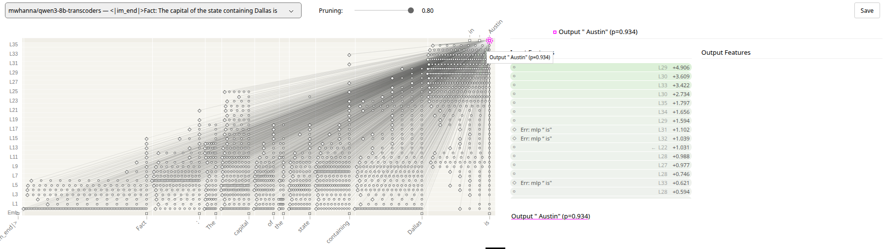

# Two-hop circuit validation

An attribution graph from [circuit-tracer](https://github.com/decoderesearch/circuit-tracer) suggests that Qwen3-8B answers *"the capital of the state containing Dallas"* by routing through a **Texas** representation. This repo turns that one graph into a regression suite: 57 city → state → capital prompts, an independent feature labeller, ablations against random controls, and feature swaps between states.

Write-up with charts: **[curreri.cc/circuits](https://curreri.cc/circuits)**



## Results

49 prompts tested: 57 built, 50 answered correctly, 1 with no labelled state features.

| Test | Result |
| --- | --- |
| Switch off the labelled state features | median P(correct capital) **0.97 → 0.18**; below 0.5 in **31 / 49** |
| Control: switch off the same number of random graph features (same positions, 3 draws) | median 0.96; below 0.5 in **0 / 49** |
| Same, with attention free to respond | 28 / 49 vs 2 / 49 for the control |
| Swap in another state's features at 1× / 2× their recorded activation | answer becomes the donor's capital in 15 / 49 and **28 / 49** |

- In 11 collapsed prompts the model still names a capital, just the wrong one (Dallas, Houston and Miami → *Atlanta*). That is consistent with "capital of" and "which state" being carried separately.
- **18 prompts resisted ablation** (Seattle, Charlotte, Burlington, ...). They have fewer labelled state features (median 4.5 vs 7). Zeroing *all* ~300 graph features at the city token breaks all 18, so the answer flows through transcoder features rather than around them. Whether the features the labeller missed encode the state, or a direct city → capital link, is open.

## Method

For each prompt `Fact: The capital of the state containing {city} is`:

1. Build the attribution graph (`max_feature_nodes=8192`) and prune to 80% node influence. Keep the nodes at the city token and the final token.
2. **Label state features without using the graph.** A feature counts as a state feature if its top output logits, taken from the transcoders' published feature data, name the state.
3. **Ablate** the state features (set them to 0) and measure P(first token of the capital).
4. **Control:** ablate an equal number of random non-state nodes from the same pruned graph, at the same positions.
5. **Swap:** zero the state features and inject a donor state's features at their recorded activations (1× and 2×).

Interventions use `ReplacementModel.feature_intervention` with the default frozen attention unless noted.

## Limitations

One model, one relation, one template. The labeller matches output tokens to state names, so it can miss features that encode a state without predicting its name, and ambiguous names (Washington, Georgia) can fool it. Candidates come only from the pruned graph at two positions. Probabilities use the capital's first token. The 7 prompts the model gets wrong are excluded: San Diego, Orlando, Rochester, Reno, Norfolk, Wilmington, Manchester.

## Running it

Needs a GPU with about 60 GB free for Qwen3-8B plus transcoders in bf16. It ran on one RTX PRO 6000 (96 GB).

```bash
pip install -r requirements.txt
python suite.py      # attribution ~4 s/prompt; first run is slower while feature metadata downloads
python analyze.py    # summary statistics
python diag.py       # city-token diagnostic; writes results/diag.json
```

The first run downloads ~97 GB of transcoder weights (`mwhanna/qwen3-8b-transcoders`, excluding `features/`) and fetches per-feature metadata from Hugging Face. That metadata is cached in `~/.cache/circuit-tracer-features/`.

## Files

| Path | Contents |
| --- | --- |
| `suite.py` | The suite: graphs, labelling, ablation, control, swap |
| `analyze.py` | Summary statistics from `results/results.jsonl` |
| `diag.py` | Zero all city-token graph features (the resistant-prompt diagnostic) |
| `results/results.jsonl` | Full per-prompt results, including every labelled feature and its top tokens |
| `results/per-prompt.csv` | One row per prompt |
| `results/diag.json` | Diagnostic results |

## Environment

Ubuntu 26.04, PyTorch 2.11 (CUDA 12.8), circuit-tracer at commit `255d989` (TransformerLens backend), `Qwen/Qwen3-8B` in bfloat16, transcoders `mwhanna/qwen3-8b-transcoders`, random seed 0.

Experiments, code and this write-up were developed with Claude Code.
